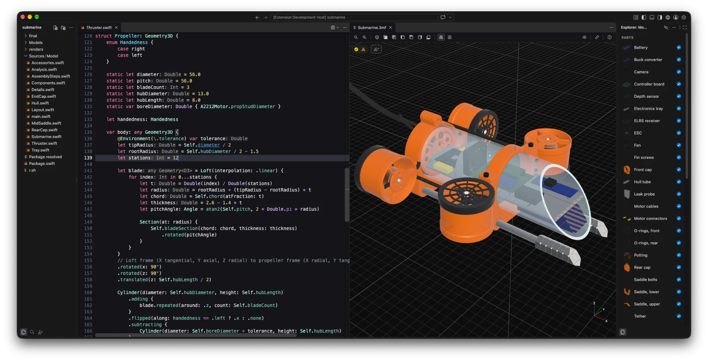

# Cadova for VS Code

Generate and preview [Cadova](https://github.com/tomasf/Cadova) models without leaving VS Code.

## Requirements

- A Swift toolchain, with `swift` on the `PATH` VS Code sees, or set in `cadova.swiftPath`.
- A Swift package whose executable builds models with Cadova.

## Features

- **Generate and Preview** actions appear above every `Model`, `Group` and `Project` in Swift files that import Cadova. They compile the package if needed, then run it to write the model files; a model's actions generate just that model, and a group's just the models in it, using Cadova's `--model` filter. A group gets no actions if one of its models is named by code rather than a plain string, since that model couldn't be included. Previewing a project or group opens every model it generates, each in a tab of its own.
- 3MF files open in a 3D preview that reloads whenever the file changes, so it follows new versions from anywhere: the actions above, the terminal or another editor.
- The preview's toolbar has Cadova Viewer's basics: perspective or orthographic projection, zoom, and the standard views (isometric, front, back, left, right, top, bottom). Hovering a standard view shows a picture of the model from that direction before you choose it. New previews start with the options you chose last, and each preview remembers its own view, including where its camera is.
- Dragging turns the view around the point under the pointer, as in Cadova Viewer, and keeps going past the edge of the screen.
- The toolbar's Show menu (the eye) turns materials, the grid, origin lines and axis directions on and off (with materials off, every part is plain white, as in Cadova Viewer), turns smooth shading on and off, and shows no edges, sharp edges or all edges. For a model with several parts, right-clicking the model lists the parts under the pointer, as in Cadova Viewer. Option-click (Alt-click) a part to show only that part; hovering one outlines it, and shows it faintly if it's hidden. Each preview remembers its hidden parts when the model is regenerated.
- The Info button shows a panel with what Cadova Viewer's info sheet has: the file's size, the model's dimensions, volume, surface area and part, vertex and triangle counts, and the 3MF file's metadata.
- The Model view in the Explorer sidebar lists the parts of the model in the active preview with thumbnails, like Cadova Viewer's parts list. Click a part's checkmark to show or hide it (Option-click to show only that part), hover it to outline it in the preview, and double-click it to center the view on it. Select several with Command-click or Shift-click, press Space to show or hide them, and right-click for Center View, Show Only and Copy Part Names. The view's menu switches between small and large icons. Below the parts, it lists the preview's measurements with their coordinates and lengths; right-click one to copy or delete it.
- The Measure button measures the model, as in Cadova Viewer: click a point, then another, to measure the length between them. Hold Command (Control) to snap to the nearest corner, Shift to keep the line along an axis, or Option (Alt) to center it on the first point. Escape cancels.
- The scissors button in the view's top left corner adds a cross-section, up to eight. Drag the gizmo's arrow to move the cut and its rings to tilt it (hold Shift for world axes, Option to turn in 22.5° steps), or use the bar along the bottom to flip it or align it to an axis. Each section's chip turns it on and off or selects it for editing. Cut faces are filled in the part's color, and measurements can land on them.
- The preview's Slice button opens the model in your slicer, as in Cadova Viewer. The first time, it offers the slicers it finds (PrusaSlicer, Bambu Studio, OrcaSlicer, UltiMaker Cura and SuperSlicer) or lets you browse for one; **Cadova: Choose Slicer…** changes it. Slicing isn't available in remote windows yet.
- Saving a Swift file regenerates the models open in previews from the same package. The preview's Regenerate button (⌥⌘R) does it on demand.

The preview works on every platform VS Code runs on. On macOS, [Cadova Viewer](https://github.com/tomasf/CadovaViewer) also works with a SpaceMouse and shows models live from Cadova LiveLink.

## Settings

- `cadova.swiftPath`: the `swift` executable to compile and run with, if it isn't on the `PATH` VS Code sees.
- `cadova.buildConfiguration`: `debug` (default) or `release`.
- `cadova.slicer`: the slicer Slice opens models in.
- `cadova.lockPointer`: hides the pointer while dragging the view, so the drag can go on past the edge of the screen. Turn it off if dragging doesn't move the view, as can happen in some virtual machines and on some Linux desktops.
- `cadova.rebuildOnSave`: turns regenerating on save off.
- `cadova.codeLens`: turns the Generate and Preview actions off.
